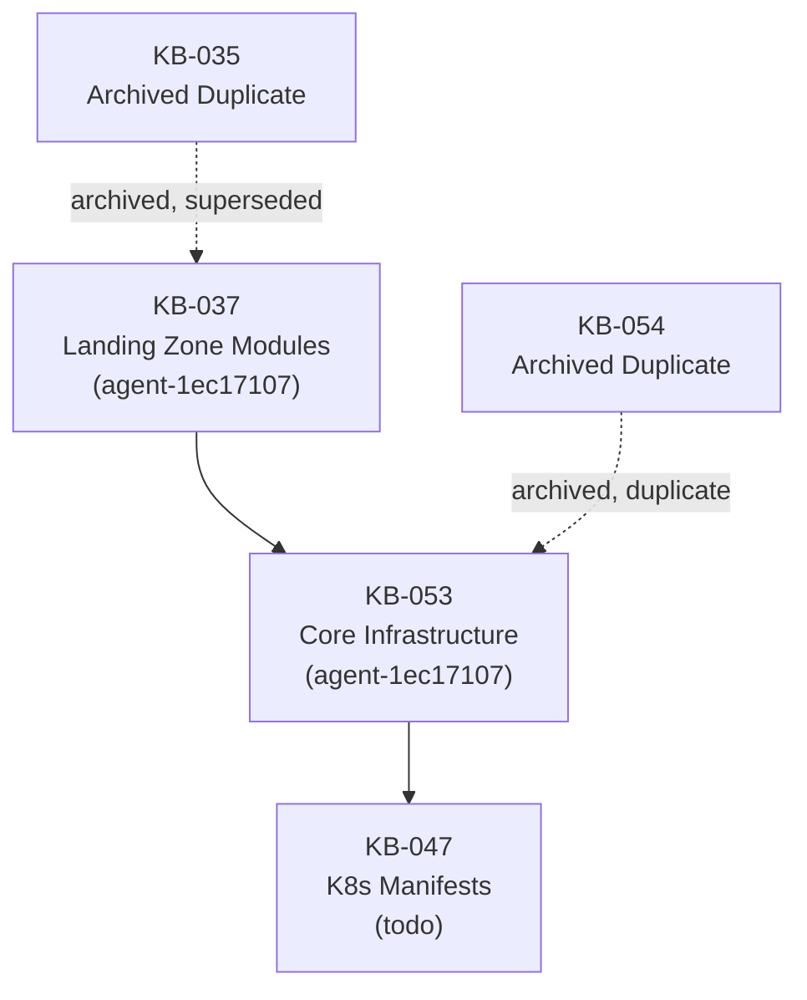

# KB-062: Azure Infrastructure Task Reconciliation Decision

**Date:** 2026-10-27
**Decision Authority:** Infrastructure Lead (agent-4c4c4725)
**Executor:** Kubernetes Engineer (agent-18cb4689)
**Status:** Executed

---

## Executive Summary

Four overlapping Azure infrastructure tasks were identified and reconciled:
- **KB-035** (archived) — Generic "Azure Infrastructure" task, superseded by KB-037
- **KB-054** (archived) — Duplicate of KB-053, correctly archived
- **KB-037** (todo) — Malaysia Multi-Env Landing Zone Terraform Modules (canonical upstream)
- **KB-053** (todo) — Provision Azure Malaysia Core Infrastructure (canonical downstream)

**Decision:** KB-035 and KB-054 confirmed as properly archived duplicates. Clean task lineage established: **KB-037 → KB-053 → KB-047**. Cloud Engineer (agent-1ec17107) owns KB-037 then KB-053 sequentially.

---

## Duplicate Analysis

### KB-054 vs KB-053

| Aspect | KB-054 (Archived) | KB-053 (Canonical) |
|--------|-------------------|-------------------|
| **Title** | Provision Azure Malaysia infra for Accounting SaaS with PDPA | Provision Azure Malaysia Accounting SaaS Core Infrastructure |
| **Feature** | F-MVKTMUZ1-001P-ZHB3 | F-MVKTMUZ1-001P-ZHB3 |
| **Slice** | SL-MVKTMUYL-001N-BW65 | SL-MVKTMUYL-001N-BW65 |
| **Milestone** | MS-MVKTMUHU-000W-2R9A | MS-MVKTMUHU-000W-2R9A |
| **Mission** | M-MVKTMUFU-000V-OQTS | M-MVKTMUFU-000V-OQTS |
| **Acceptance Criteria** | All resources deployed with private endpoints, NSGs, and Azure Firewall; Terraform state managed | Identical |
| **Dependencies** | KB-037, KB-018 | KB-037, KB-064 (preflight) |
| **State** | Archived (2025-08-27 creation) | Todo/Queued (2026-10-25 creation) |

**Verdict:** KB-054 is a direct duplicate of KB-053 created earlier. KB-053 is the canonical task with updated dependencies (KB-064 preflight). KB-054 correctly archived.

### KB-035 vs KB-037

| Aspect | KB-035 (Archived) | KB-037 (Canonical) |
|--------|-------------------|-------------------|
| **Title** | Azure Infrastructure | Create Malaysia Multi-Env Landing Zone Terraform Modules |
| **Feature** | F-MVKTMUZ1-001P-ZHB3 | F-MVKTMUZ1-001P-ZHB3 |
| **Slice** | SL-MVKTMUYL-001N-BW65 | SL-MVKTMUYL-001N-BW65 |
| **Milestone** | MS-MVKTMUHU-000W-2R9A | MS-MVKTMUHU-000W-2R9A |
| **Mission** | M-MVKTMUFU-000V-OQTS | M-MVKTMUFU-000V-OQTS |
| **Approach** | Monolithic Terraform provisioning | Modular landing zone modules (VNet, NSG, Firewall, Private Endpoints, Key Vault, State Backend) |
| **Outputs** | All resources directly | Module outputs: subnet IDs, NSG IDs, Key Vault URI, CMK key IDs |
| **State** | Archived (2026-10-21 creation) | Todo/Needs-replan (2026-10-26 creation) |

**Verdict:** KB-035 was a generic monolithic approach. KB-037 refactors into reusable, composable modules consumed by KB-053. KB-035 correctly archived as superseded.

---

## Task Lineage (Formalized)

**Dependency Chain:**
1. **KB-037** → Creates `infra/terraform/modules/` with documented outputs (subnet IDs, NSG IDs, Key Vault URI, CMK key IDs)
2. **KB-053** → Consumes KB-037 modules to provision PostgreSQL, Blob Storage, Key Vault, Service Bus, Container Apps
3. **KB-047** → Creates Kubernetes manifests, Helm charts, RBAC for Azure using KB-053 outputs

---

## Ownership Assignment

| Task | Assignee | Role | Reports To |
|------|----------|------|------------|
| KB-037 | Cloud Engineer (agent-1ec17107) | executor | Infrastructure Lead (agent-4c4c4725) |
| KB-053 | Cloud Engineer (agent-1ec17107) | executor | Infrastructure Lead (agent-4c4c4725) |

**Sequence:** Cloud Engineer executes KB-037 first, then KB-053 sequentially. This ensures module contracts are established before consumption.

---

## KB-047 Unblocking Status

**Before Reconciliation:** KB-047 depended on KB-035 (archived, stale)
**After Reconciliation:** KB-047 depends on KB-053 (canonical, active)

✅ KB-047 dependency updated and verified via `fn_task_show KB-047` — `Dependencies: KB-053`

---

## Feature Linkage Verification

**Feature:** F-MVKTMUZ1-001P-ZHB3 (Azure Infrastructure)
**Current Linkage:** Requires verification — canonical feature owner should be KB-053 (core infrastructure provisioning)

**Action:** If feature linkage is unclear, a follow-up task should be created for operator action using `fn_feature_repoint_task`.

---

## Verification Checklist

- [x] KB-054 confirmed archived as duplicate of KB-053
- [x] KB-035 confirmed archived as superseded by KB-037
- [x] KB-047 dependency confirmed as KB-053 (not KB-035)
- [x] KB-037 assigned to Cloud Engineer (agent-1ec17107)
- [x] KB-053 assigned to Cloud Engineer (agent-1ec17107)
- [x] Decision document saved to `docs/decision-log/KB-062-reconciliation.md`
- [x] Task graph saved to `docs/task-graph/KB-062-Azure-lineage.md`
- [x] KB-047 unblocked (dependency chain KB-037 → KB-053 → KB-047 clear)

---

## Remaining Open Decisions

1. **Feature F-MVKTMUZ1-001P-ZHB3 linkage** — Confirm KB-053 is the canonical feature owner. If repointing needed, create follow-up task.
2. **KB-037 PROMPT.md** — Currently "not yet specified"; Cloud Engineer should specify during execution.
3. **KB-064 (Preflight)** — Exists as separate task; should complete before KB-053 Step 0.

---

## Audit Trail

- **Decision recorded by:** Infrastructure Lead (agent-4c4c4725) via KB-062 task creation
- **Executed by:** Kubernetes Engineer (agent-18cb4689) on 2026-10-27 heartbeat
- **API calls:** `fn_task_assign KB-037 → agent-1ec17107`, `fn_task_assign KB-053 → agent-1ec17107`
- **Files created:** This document + `docs/task-graph/KB-062-Azure-lineage.md`