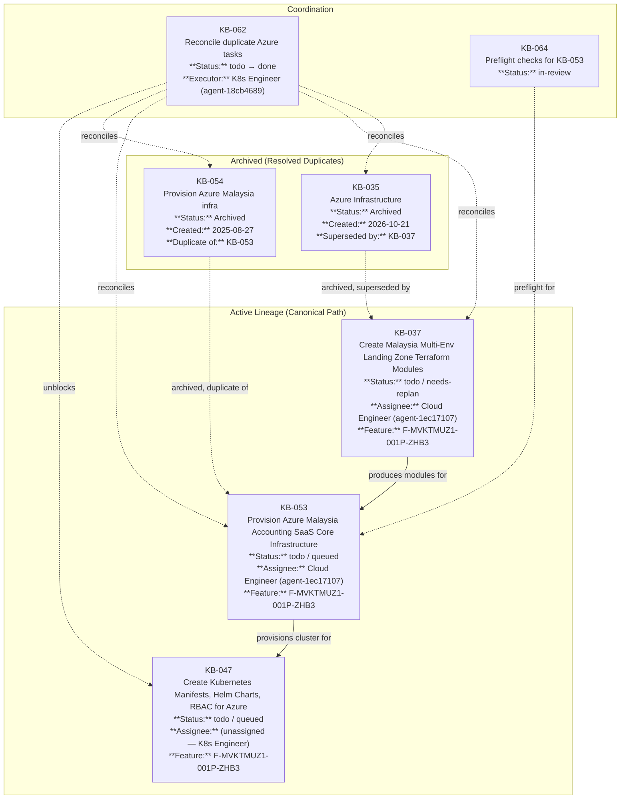

# KB-062: Azure Infrastructure Task Lineage Graph

**Generated:** 2026-10-27
**Source Task:** KB-062 (Reconcile duplicate Azure KB-035/037/053/054 tasks)

---

## Corrected Task Dependency Graph



---

## Task Details

### Active Tasks (Execution Order)

| Order | Task ID | Title | Status | Assignee | Dependencies |
|-------|---------|-------|--------|----------|--------------|
| 1 | KB-037 | Create Malaysia Multi-Env Landing Zone Terraform Modules | todo / needs-replan | Cloud Engineer (agent-1ec17107) | — |
| 2 | KB-053 | Provision Azure Malaysia Accounting SaaS Core Infrastructure | todo / queued | Cloud Engineer (agent-1ec17107) | KB-037, KB-064 |
| 3 | KB-047 | Create Kubernetes Manifests, Helm Charts, RBAC for Azure | todo / queued | (unassigned) | KB-053 |

### Archived Tasks (Resolved)

| Task ID | Title | Resolution |
|---------|-------|------------|
| KB-035 | Azure Infrastructure | Superseded by KB-037 (modular approach) |
| KB-054 | Provision Azure Malaysia infra for Accounting SaaS with PDPA | Duplicate of KB-053 |

### Coordination Tasks

| Task ID | Title | Status | Purpose |
|---------|-------|--------|---------|
| KB-062 | Reconcile duplicate Azure KB-035/037/053/054 tasks | Executing | Formalize lineage, assign ownership, unblock KB-047 |
| KB-064 | Preflight checks for KB-053 Azure infrastructure provisioning | in-review | Verify Azure CLI, Terraform, npm deps before KB-053 |

---

## Mission / Feature / Slice / Milestone Context

```
Mission: M-MVKTMUFU-000V-OQTS (Malaysia Accounting SaaS Core Foundation)
└── Milestone: MS-MVKTMUHU-000W-2R9A (Platform & Core Infrastructure)
    └── Slice: SL-MVKTMUYL-001N-BW65 (Development Environment & CI/CD)
        └── Feature: F-MVKTMUZ1-001P-ZHB3 (Azure Infrastructure)
            ├── KB-037: Landing Zone Modules (canonical upstream)
            ├── KB-053: Core Infrastructure (canonical midstream)
            └── KB-047: K8s Manifests (downstream consumer)
```

---

## Agent Ownership Chain

```
Infrastructure Lead (agent-4c4c4725) — Director of Infrastructure & Cloud
    └── Cloud Engineer (agent-1ec17107) — Senior Cloud Architect (executor)
        ├── KB-037 (landing zone modules) — FIRST
        └── KB-053 (core infrastructure) — SECOND (depends on KB-037)
    └── Kubernetes Engineer (agent-18cb4689) — Senior Kubernetes Engineer
        └── KB-047 (K8s manifests) — DEPENDS ON KB-053
    └── Database Engineer (agent-22c9213d) — Senior Database Engineer
        └── KB-027 (PostgreSQL RLS) — PARALLEL
```

---

## Key Outputs by Task

### KB-037 Outputs (Module Contracts)
- `infra/terraform/modules/vnet/` — VNet, subnets (PostgreSQL, Container Apps, Service Bus, Private Endpoints)
- `infra/terraform/modules/nsg/` — Network Security Groups with deny-by-default + Azure service tags
- `infra/terraform/modules/firewall/` — Azure Firewall with DNS proxy, threat intelligence
- `infra/terraform/modules/private_endpoints/` — Private endpoints for all PaaS services
- `infra/terraform/modules/keyvault/` — Key Vault with CMK per environment
- `infra/terraform/modules/state_backend/` — Remote state backend (Azure Storage + blob leases)
- `infra/README.md` — **Contract document** with all output references for downstream consumers

### KB-053 Outputs (Provisioned Infrastructure)
- PostgreSQL Flexible Server (private access, `southeastasia`)
- Storage Account (private endpoints, versioning, immutable containers)
- Key Vault (RBAC, purge protection, secrets)
- Service Bus (private endpoint, topics: filings, compliance-events, audit-trail)
- Container Apps Environment (vNet integration, private ingress, Dapr)
- CI/CD pipelines (terraform-plan.yml, terraform-apply.yml with approval gates)

### KB-047 Outputs (Kubernetes Platform)
- Multi-tenant namespaces (`csaas-core`, `csaas-tenant-dev/staging/prod`)
- Service accounts per component (`csaas-api`, `csaas-worker`, `csaas-scheduler`)
- RBAC ClusterRoles/RoleBindings (least-privilege)
- Pod Security Standards (restricted/baseline, Enforce mode)
- Security contexts (runAsNonRoot, readOnlyRootFilesystem, no privilege escalation)
- NetworkPolicies (intra-tenant allow, inter-tenant deny, Azure service tag egress)
- Helm chart `azure-container-apps` with dev/staging/prod value files
- GitHub Actions workflows for dev/staging/prod deployment

---

## Verification Commands

```bash
# Verify task states
fn_task_show KB-035  # Should show column: archived
fn_task_show KB-054  # Should show column: archived
fn_task_show KB-037  # Should show assignee: agent-1ec17107
fn_task_show KB-053  # Should show assignee: agent-1ec17107
fn_task_show KB-047  # Should show dependencies: ["KB-053"]
fn_task_show KB-062  # Should show progress on steps

# Verify agent assignments
fn_agent_show agent-1ec17107  # Cloud Engineer, reports to agent-4c4c4725
fn_agent_show agent-4c4c4725  # Infrastructure Lead, direct reports include Cloud Engineer
```

---

## Next Actions

1. **Cloud Engineer** begins KB-037 (specify PROMPT.md, create module structure)
2. **Kubernetes Engineer** (this agent) monitors KB-037/KB-053 progress
3. **KB-064** completes preflight → unblocks KB-053 Step 0
4. **KB-047** begins Step 0 Preflight once KB-053 provisions cluster